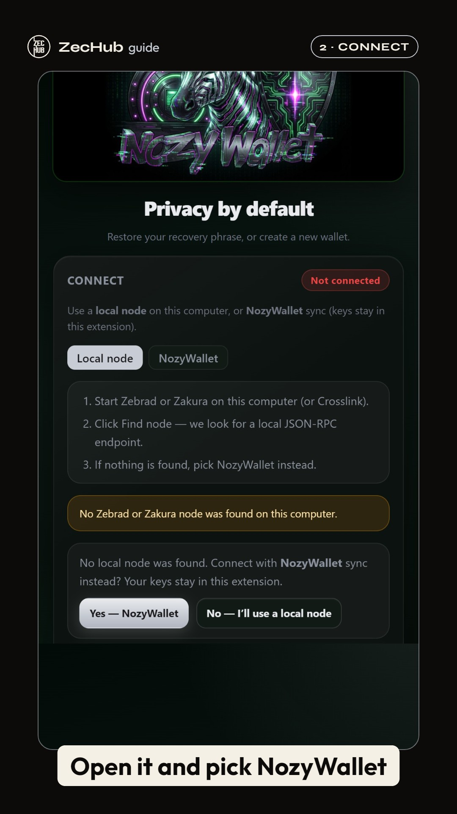
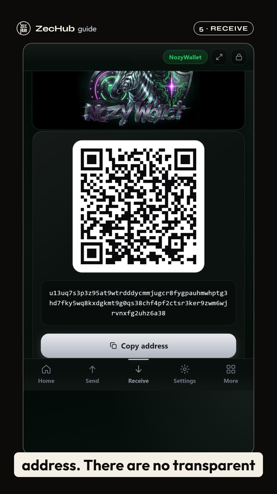
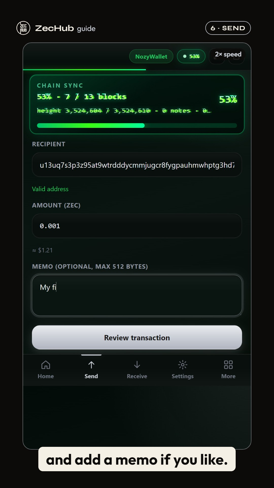
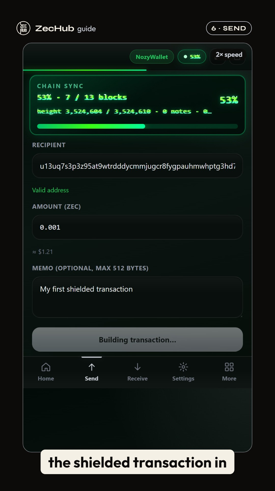

# NozyWallet walkthrough (90 s, 9:16)

A short vertical walkthrough of the [NozyWallet](https://github.com/LEONINE-DAO/Nozy-wallet) Chrome extension, from install to receive to send, for X and YouTube Shorts. ZecHub produced it.

**Video:** [`out/nozywallet-walkthrough-9x16.mp4`](out/nozywallet-walkthrough-9x16.mp4) is 1080×1920, 30 fps, exactly 1:30, with AAC voiceover normalised to −16 LUFS and burned-in captions.
**Captions file:** [`out/nozywallet-walkthrough.srt`](out/nozywallet-walkthrough.srt), for platforms that take a separate track.

| | |
|---|---|
|  |  |
|  |  |

## What's on screen

All footage is a real screen recording of the **latest releases as of 20 Oct 2026**:

- **Extension 2.0.3 "Sweet Chili"** (GitHub release `extension-v2.0.3`, marked Latest)
- **Companion `nozywallet-api` 2.4.8 "Mango Habanero"**, verified against the release's SHA-256

| Time | Step | Shown |
|---|---|---|
| 0:00 | Hook | Title over the real extension |
| 0:09 | 1 · Install | Chrome Web Store listing and the GitHub Latest release |
| 0:15 | 2 · Connect | NozyWallet sync (`lwd.nozywallet.org`), with your own Zebra node as the alternative |
| 0:23 | 3 · Create | Create wallet, set password |
| 0:30 | 4 · Back up | Reveal and verify the 24 words. The whole screen is blurred for this step |
| 0:38 | 5 · Receive | Orchard, Ironwood and Sapling pools; Receive shows the u1 unified address and QR |
| 0:51 | 5 · Receive | Balance updates after sync (the demo wallet is empty) |
| 0:58 | 6 · Send | Recipient, amount and memo; companion app requirement |
| 1:08 | 6 · Send | Review → "Building transaction…" |
| 1:17 | Outro | What shielded transactions encrypt; GitHub link |

## Acceptance notes

- **Privacy:** throwaway wallet, never funded. The recovery phrase and the verify-step words are blurred across every frame of the backup step (full-screen blur from reveal to home screen). The balance is 0.
- **Accuracy:** no "untraceable" claims. Every statement matches observed behaviour or the extension source:
  - keys stay in the extension;
  - the transaction is built and proved in a worker inside the browser;
  - with NozyWallet (remote) sync, broadcast goes through the local companion API (`broadcastRawHex` in `background/service-worker.js`);
  - there are no transparent addresses: `t1` is rejected for send and receive.
- **Not shown:** a broadcast transaction. The demo wallet had no funds, so the video stops at Review, says so plainly, and the end card reads "unfunded: no transaction was broadcast". To include a real send, fund the wallet and re-run phase B (below).
- **Audio:** the voiceover is Windows TTS (Microsoft Zira) with no music. To use a human voice, record the lines in [`script.json`](script.json) and replace the WAVs in `audio/`. The timing adapts to the new lengths.

## Brand

- **Nozy:** Ink `#0C0B09`, Paper `#F5F0E6`, Silver `#C8CCD4`; Syne (display) and Outfit (body).
- **ZecHub:** the official mark (`ZecHubWhite.svg`) as the producer credit in the header and end card, kept clear of other elements and unaltered.

## Rebuild

Requires Node 18+, Microsoft Edge, Windows (for TTS) and the unpacked extension at `../nozy-ext-dl/ext/nozy-extension`.

```sh
npm install
node record-install.mjs          # rec/I: store + GitHub release
node record.mjs A                # rec/A: connect, create, back up, receive (prints the receive address)
NO_FUNDS=1 SEND_TO=<u1…> node record.mjs B   # rec/B: send form + review (no broadcast)
SEND_TO=<u1…> node record.mjs B             # rec/B: real send once the wallet is funded (companion on 127.0.0.1:3000)
powershell -File tts.ps1 -Script script.json -Out audio
node render-walk.mjs             # out/nozywallet-walkthrough-9x16.mp4 + .srt
```

Recording uses a 1080×1920 viewport with CSS `zoom: 2.7`, so the 400 px extension UI is captured at native resolution. `render-walk.mjs` times every segment to its voice line, lands the cut at exactly 90 s, and adds the tap rings, speed badges, the privacy blur and the captions.
